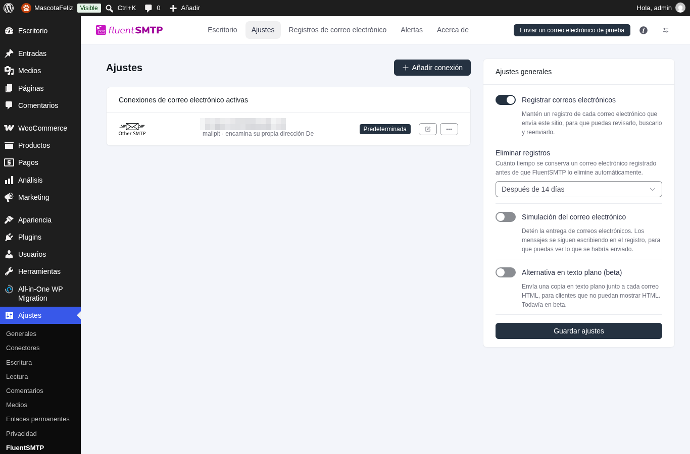
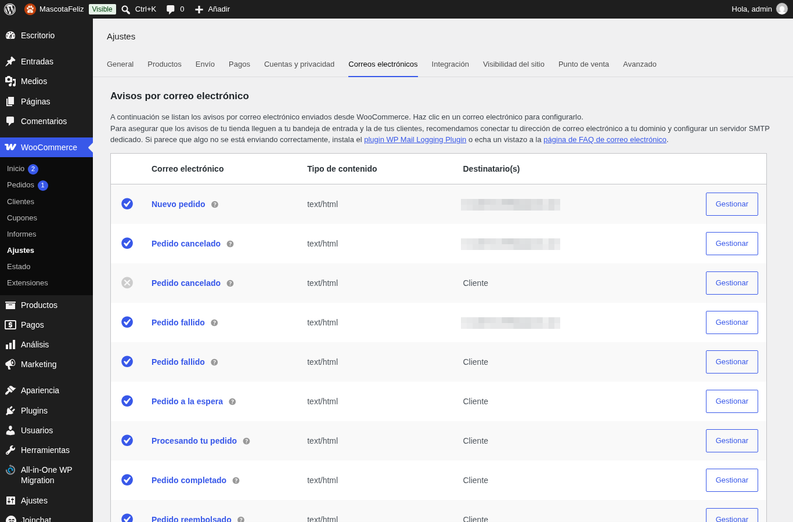
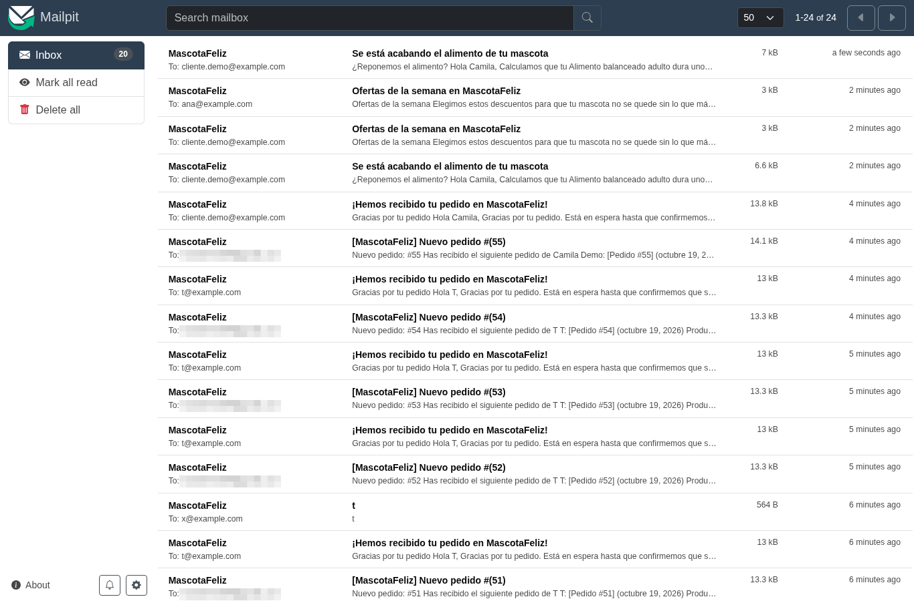
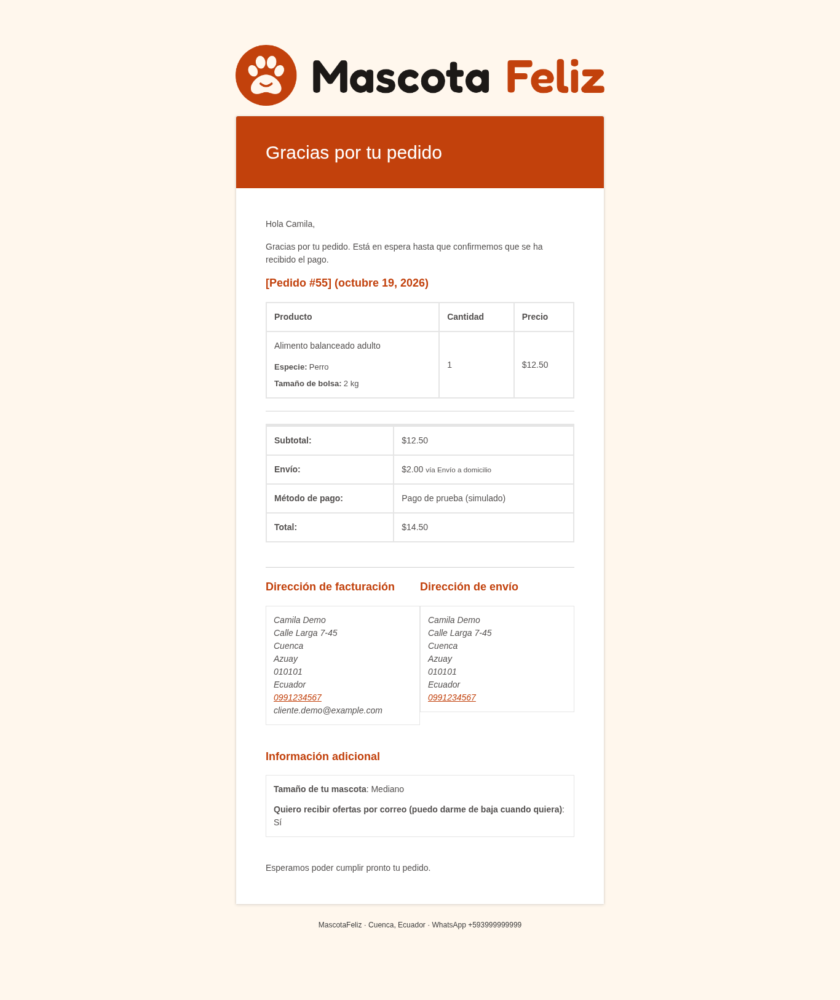
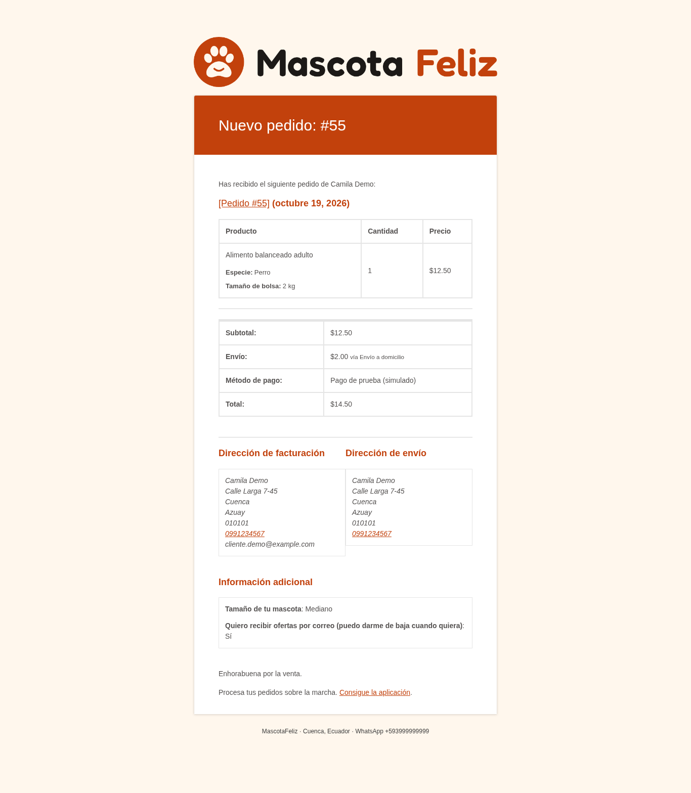
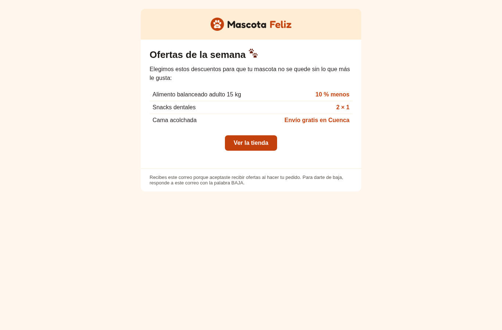

# Correo — Integrante B

## Proveedor SMTP

| Entorno | Servicio | Configuración |
|---|---|---|
| Local | Mailpit (contenedor) | FluentSMTP → host `mailpit`, puerto 1025, sin autenticación |
| Sitio final | Brevo | FluentSMTP → `smtp-relay.brevo.com`, puerto 587, TLS, usuario y clave SMTP de Brevo |

**Por qué Brevo y no Gmail:** el plan gratuito permite 300 correos al día sin tarjeta, deja verificar el dominio remitente (SPF/DKIM) para que los correos no caigan en spam y separa el correo de la tienda de una cuenta personal. Gmail con contraseña de aplicación sirve como plan B, pero limita el envío y muestra la cuenta personal como remitente.

**Por qué FluentSMTP:** es gratuito y sin funciones de pago, registra cada correo enviado y permite cambiar de proveedor sin tocar código.

Las credenciales van solo en el panel de FluentSMTP del sitio final, nunca en el repositorio ni en las capturas.

## Correos de la tienda

| Correo | Destinatario | Cuándo | Plantilla |
|---|---|---|---|
| Confirmación de pedido | Cliente | Al hacer el pedido | Override `plantillas-correo/emails/customer-processing-order.php`: saludo propio y enlace a WhatsApp |
| Nuevo pedido | Administrador | Al hacer el pedido | Plantilla de WooCommerce con colores y logo de la marca |
| Recordatorio de recompra | Cliente | 5 días antes de que se acabe la bolsa | Plugin de recompra (ver la sección del integrante C) |
| Ofertas | Clientes que aceptaron | Envío manual: `wp mascotafeliz ofertas` | `plantillas-correo/ofertas.html` |

Todos usan la misma marca: cabecera con el logo, botones naranja `#C2410C`, fondo crema y pie con la ciudad y el WhatsApp.

## Ofertas con consentimiento

- Casilla «Quiero recibir ofertas por correo» en el checkout, **desmarcada por defecto** y opcional: solo cuenta un consentimiento activo.
- La respuesta se guarda en el pedido y aparece en el panel.
- `wp mascotafeliz ofertas` envía `ofertas.html` solo a quienes la marcaron, una vez por dirección.
- Cada correo explica por qué lo recibe la persona y cómo darse de baja (responder «BAJA»).

