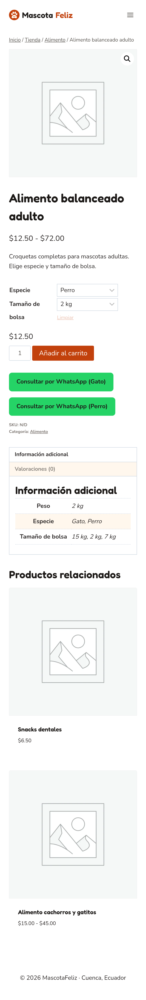
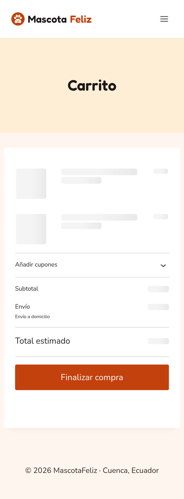
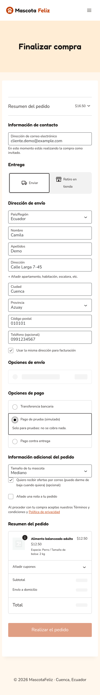
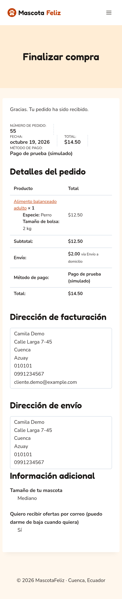

# Manual de pedido

Guía para comprar en MascotaFeliz desde el celular o el computador.

**1. Elige el producto.** Entra a la tienda desde el menú o desde «Ver la tienda» en el inicio. Puedes filtrar por categoría: Alimento, Accesorios, Higiene o Juguetes.

**2. Elige especie y tamaño de bolsa** (solo en el alimento) y pulsa **Añadir al carrito**. Si tienes dudas sobre la raza o la ración, pulsa **Consultar por WhatsApp**: se abre el chat con el producto ya escrito.

**3. Revisa el carrito** y pulsa **Finalizar compra**.

**4. Completa tus datos:**

- Correo electrónico: ahí llegan la confirmación y el recordatorio.
- Entrega: **Enviar** a domicilio o **Retiro en tienda** (gratis).
- Dirección y código postal. En Cuenca empieza por `0101`: el envío cuesta $2; resto de Azuay $4; resto del país $8.
- **Tamaño de tu mascota**: lo usamos para avisarte antes de que se acabe el alimento.
- Si quieres ofertas, marca la casilla. Es opcional.

**5. Elige cómo pagar:** transferencia bancaria (envías el comprobante por WhatsApp) o en efectivo contra entrega. Pulsa **Realizar el pedido**.

**6. Listo.** Verás el resumen del pedido y te llegará un correo de confirmación.

**7. Antes de que se acabe el alimento** te escribimos con dos botones: **Volver a comprar** (el mismo producto va directo al carrito) o **Pedir por WhatsApp**.
