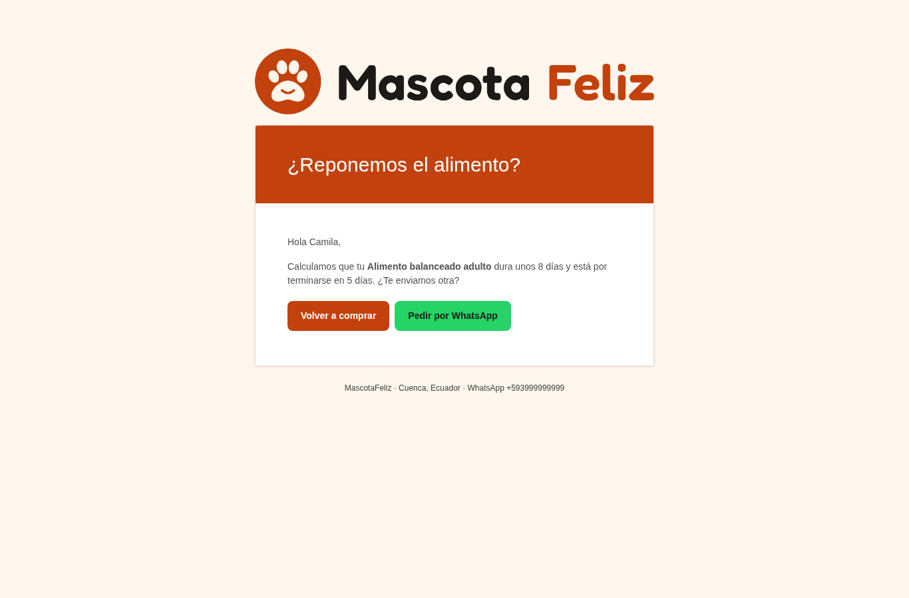
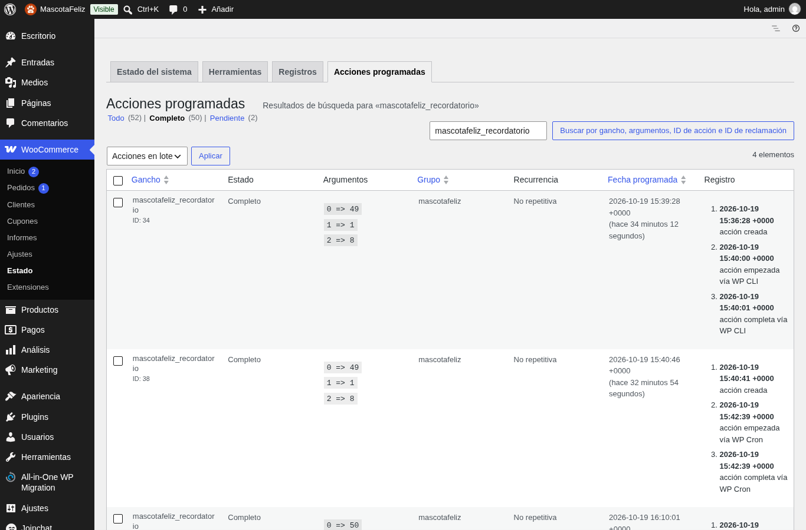
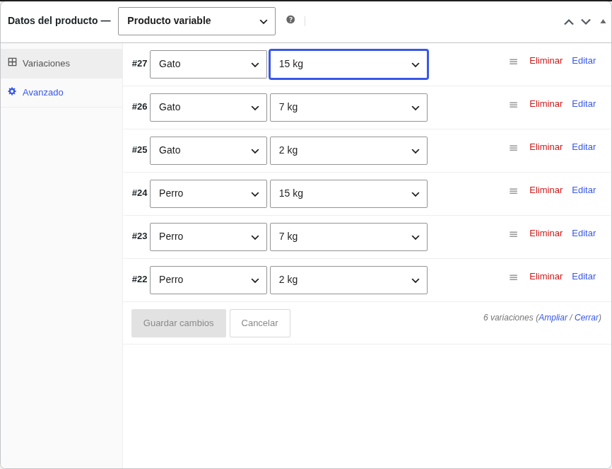
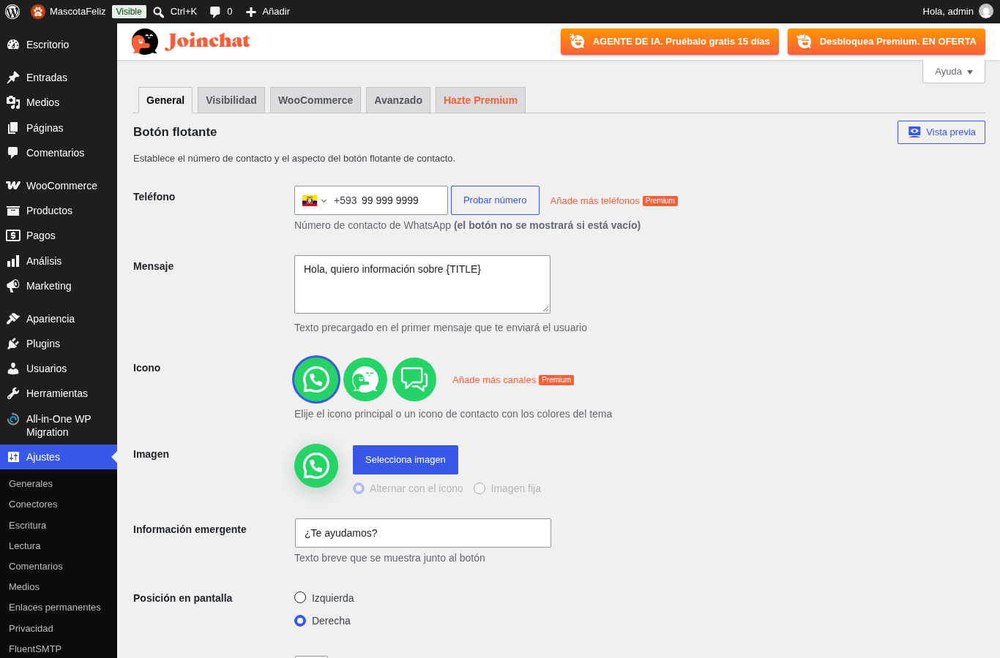

# Reto técnico y WhatsApp — Integrante C

## Lógica del reto: recordatorio de recompra

El plugin `plugin-recompra/` avisa al cliente antes de que se le acabe el alimento:

1. En el checkout el cliente indica el **tamaño de su mascota** (pequeño, mediano o grande).
2. Cuando el pedido pasa a *en espera*, *procesando* o *completado*, el plugin recorre los productos de la categoría Alimento y toma el **peso de la variación** comprada (2, 7 o 15 kg) y su **especie**.
3. Calcula los días que dura la bolsa y programa con **Action Scheduler** (la cola de tareas de WooCommerce) un correo para **5 días antes** del final.
4. El pedido se marca para no programar el recordatorio dos veces si cambia de estado de nuevo.
5. El correo trae dos botones: **Volver a comprar** (añade la misma variación al carrito) y **Pedir por WhatsApp** (chat con el mensaje ya escrito).

**Modo prueba:** con la opción `mascotafeliz_modo_prueba = yes` los días cuentan como minutos, para mostrar el recordatorio en la demo. En el sitio final se pone en `no`.







## Fórmula de consumo

```
días = (peso de la bolsa en kg × cantidad × 1000) / gramos diarios
aviso = días − 5   (mínimo 1)
```

| Especie | Pequeño | Mediano | Grande |
|---|---|---|---|
| Perro (g/día) | 100 | 250 | 400 |
| Gato (g/día) | 40 | 60 | 80 |

**Justificación:** un perro adulto come alrededor de 2–3 % de su peso al día en alimento seco: unos 100 g para uno pequeño (≈5 kg), 250 g para uno mediano (≈12 kg) y 400 g para uno grande (≈20–25 kg). Un gato adulto de 3–5 kg come 40–80 g. Son valores medios: cada marca indica su propia ración en la bolsa y cambian con la edad y la actividad. Por eso el aviso se manda **5 días antes**: el margen absorbe el error de la estimación y el tiempo de envío.

Ejemplo: bolsa de 2 kg para un perro mediano → 2000 / 250 = **8 días** → aviso el día 3.

La función `mf_dias()` tiene una autocomprobación en `plugin-recompra/tests/dias.php`.

## WhatsApp en la tienda

| Pieza | Cómo funciona |
|---|---|
| Botón en cada ficha | Enlace `wa.me` con el mensaje precargado: «Hola, quiero información sobre *producto* para mi *especie*. Raza: ». Si el producto tiene varias especies sale un botón por especie, y el cliente completa la raza |
| Joinchat | Botón flotante en todo el sitio con el número de la tienda y un saludo. No se abre solo, para no tapar el checkout en el celular |
| Correo de recordatorio | Botón «Pedir por WhatsApp» con el nombre del producto |
| Confirmación de pedido | Enlace con el número de pedido para consultas |

El número está en un solo lugar (`mascotafeliz_whatsapp`) y lo fija `MF_WHATSAPP=5939XXXXXXXX sh scripts/configurar.sh`.




## API de WhatsApp Business: requisitos y limitaciones

Los enlaces `wa.me` solo abren un chat: es el cliente quien escribe. Para que la tienda **envíe** los recordatorios por WhatsApp de forma automática haría falta la API de WhatsApp Business (Cloud API de Meta):

- **Cuenta y número:** cuenta comercial de Meta (*Business Manager*), una app de desarrollador y un número que no esté en uso en la app de WhatsApp. El nombre visible pasa por la aprobación de Meta.
- **Plantillas aprobadas:** los mensajes que inicia la empresa (como un recordatorio) deben ser plantillas revisadas por Meta. Un recordatorio de recompra con oferta sería de categoría *marketing*.
- **Ventana de 24 horas:** fuera de las 24 horas desde el último mensaje del cliente solo se pueden mandar plantillas. Dentro de la ventana, las respuestas libres son gratis.
- **Costo:** desde julio de 2025 Meta cobra por cada plantilla entregada según la categoría y el país del destinatario. El marketing se cobra siempre; las de utilidad y autenticación son gratis dentro de la ventana.
- **Límites:** los números nuevos parten con un tope diario de destinatarios que sube con la verificación del negocio y la calidad de los envíos.
- **Consentimiento:** el cliente debe aceptar recibir mensajes por WhatsApp, igual que con las ofertas por correo.

**Conclusión:** para una tienda pequeña y un proyecto académico el costo y el trámite no compensan. El recordatorio va por correo, que es gratis y no necesita aprobación, con un botón a WhatsApp para que el cliente inicie la conversación. Si la tienda creciera, el paso siguiente sería una plantilla de utilidad enviada desde el mismo `mascotafeliz_recordatorio`.

Fuentes: [Precios de la plataforma de WhatsApp Business (Meta)](https://developers.facebook.com/docs/whatsapp/pricing), [WhatsApp API Pricing Explained (2026)](https://www.authgear.com/post/whatsapp-api-pricing), [WhatsApp Business API Pricing in 2026](https://www.unipile.com/whatsapp-business-api-pricing/).
