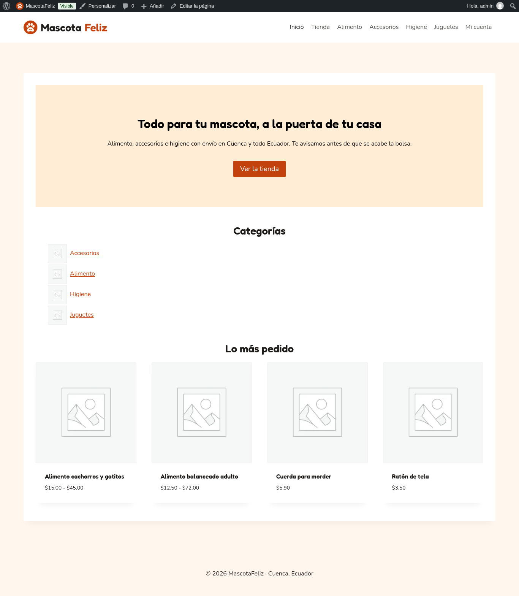
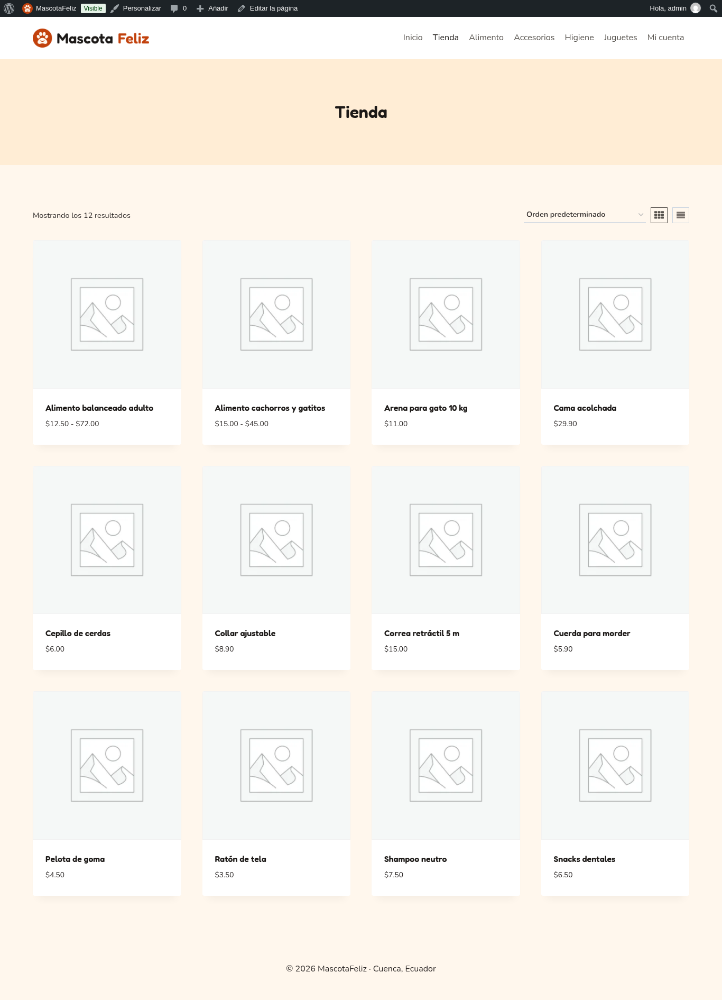
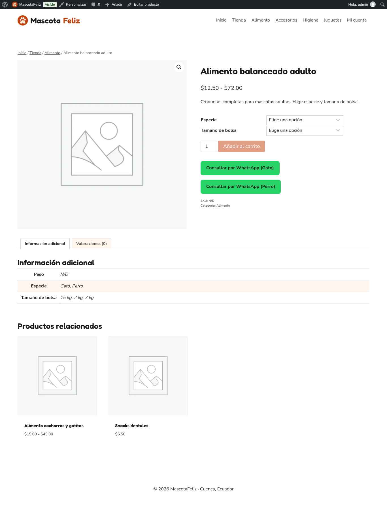
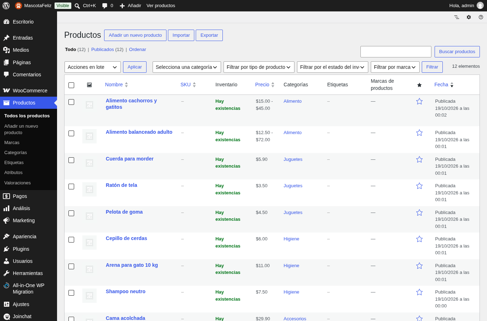
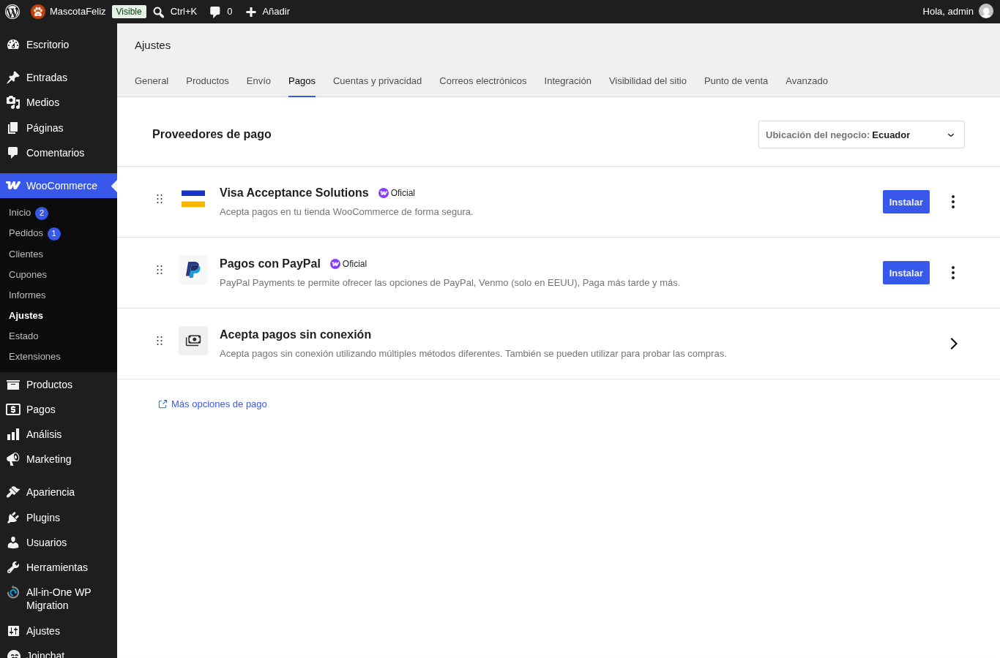
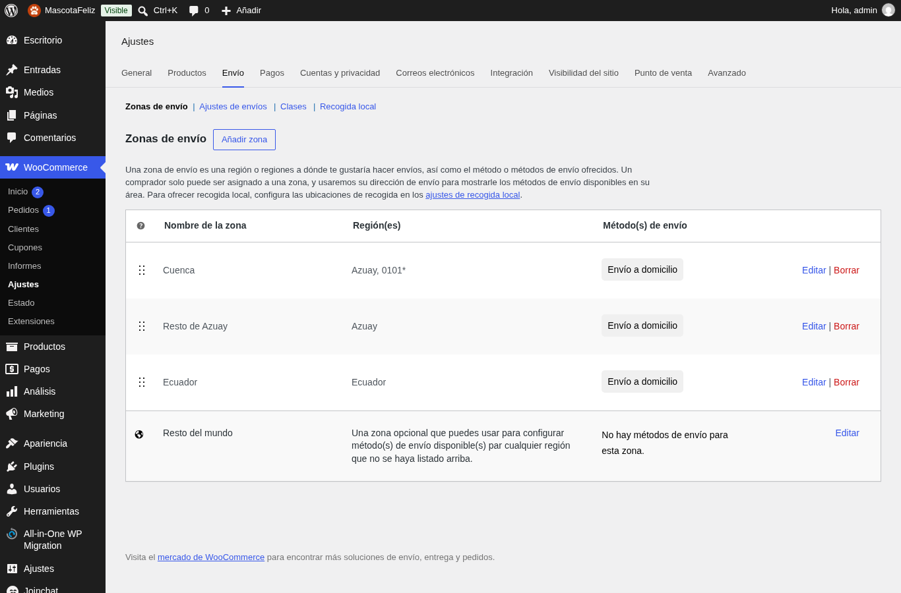
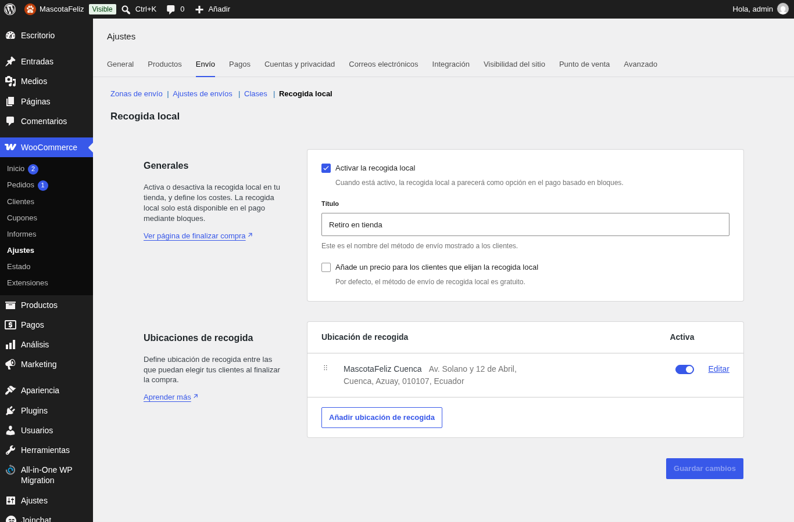
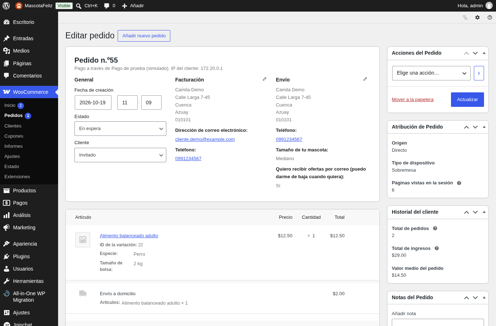
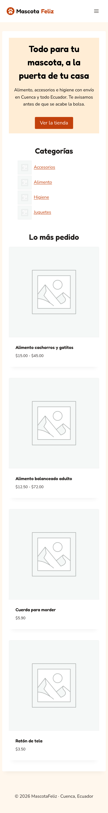

# Tienda (WooCommerce) — Integrante A

## Plataforma

| Pieza | Elección | Motivo |
|---|---|---|
| CMS | WordPress + WooCommerce 11 | Estándar para tiendas pequeñas, gratuito y con checkout de bloques |
| Tema | Kadence | Ligero, con paleta global de 9 colores y buena vista móvil |
| Entorno | Docker Compose (WordPress, MariaDB, Mailpit, cron) | Mismo entorno para los tres integrantes |
| Configuración | `scripts/configurar.sh` (WP-CLI) | Repetible: deja la tienda igual en cualquier equipo |

## Catálogo

Cuatro categorías (Alimento, Accesorios, Higiene, Juguetes) y 12 productos. El alimento es un **producto variable** con dos atributos: *Especie* (Perro, Gato) y *Tamaño de bolsa* (2, 7 y 15 kg). Cada variación guarda su peso en el campo nativo de WooCommerce, que el plugin de recompra usa para calcular cuánto dura la bolsa.

Las fotos de producto son de Wikimedia Commons con licencia libre (CC0, dominio público, CC BY y CC BY-SA), recortadas a 800×800 px. Están en `scripts/fotos/` con el slug de cada producto como nombre y `configurar.sh` las asigna; los autores están en [`scripts/fotos/CREDITOS.md`](../scripts/fotos/CREDITOS.md). Cada categoría usa la foto de uno de sus productos.

## Pagos

| Método | Uso |
|---|---|
| Transferencia bancaria | Datos de cuenta en el pedido; se despacha al confirmar el pago |
| Pago contra entrega | Efectivo al recibir |
| Pago de prueba (simulado) | Para la demo: no cobra. WooCommerce no trae pasarela de prueba propia, así que se usa el método «cheque» renombrado |

## Envíos

WooCommerce usa la **primera zona que coincide**, por eso Cuenca va antes que Azuay. En Ecuador los dígitos 3–4 del código postal son el cantón: Cuenca es `0101`.

| Zona | Regla | Costo |
|---|---|---|
| Cuenca | Azuay + código postal `0101*` | $2,00 |
| Resto de Azuay | Provincia Azuay | $4,00 |
| Ecuador | País | $8,00 |
| Retiro en tienda | MascotaFeliz Cuenca, lunes a sábado 9:00–18:00 | Gratis |

## Checkout

Checkout de bloques con dos campos propios del plugin: **tamaño de la mascota** (obligatorio, alimenta el cálculo de recompra) y **consentimiento para ofertas** (opcional, desmarcado por defecto).

## Decisiones de diseño

- **Paleta cálida** (naranja quemado `#C2410C` sobre crema `#FFF7ED`): transmite cercanía y se diferencia de las tiendas de mascotas en azul. Todo texto pasa WCAG AA; el naranja vivo `#F97316` se descartó porque con texto blanco da 2,8:1.
- **Sin verde en la marca**: el verde queda para WhatsApp, así el botón de consulta destaca solo.
- **Tipografía** Fredoka (títulos, redondeada y amigable) y Nunito (texto, 16 px).
- **Móvil primero**: la mayoría de clientes compra desde el celular. Productos en dos columnas, menú en panel lateral y chat de WhatsApp sin apertura automática para no tapar el formulario.

## Revisión desde el celular

Recorrido completo en 390 × 844 px (tamaño de un iPhone 13/14): inicio → menú → tienda → ficha → carrito → checkout → pedido recibido. Sin desplazamiento horizontal ni errores de consola en ninguna página.

Errores encontrados y corregidos en la revisión:

| Error | Causa | Arreglo |
|---|---|---|
| El chat de Joinchat se abría solo y tapaba el checkout | Apertura automática a los 10 s por defecto | `message_delay = -1` |
| Textos del checkout en inglés («Delivery», «Add coupons») | Traducción es_EC de WooCommerce incompleta | Sitio en es_ES |
| El checkout tardaba 15 s | MariaDB hace fsync en cada commit y en btrfs cuesta ~150 ms | `innodb_flush_log_at_trx_commit=2` (solo local) |
| Productos en una columna: mucho scroll | Valor por defecto de Kadence | Dos columnas en móvil |
| Pie con «Tema para WordPress por Kadence WP» | Texto por defecto | Pie con la marca |
